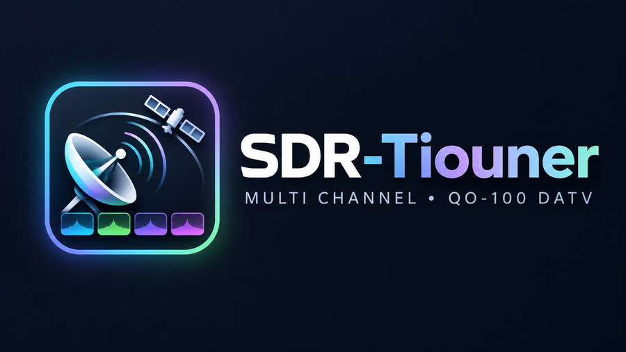
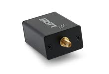
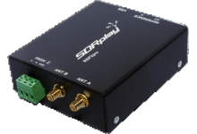
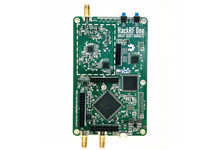
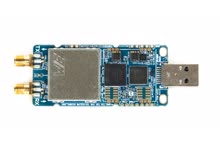
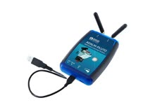
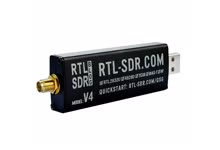

<h2 align="center">DEMO</h2>

  
   
  Click the picture to watch the demo on YouTube

# SDR-Tiouner

**Watch amateur television from QO-100 on your PC.** SDR-Tiouner, by HB9IIU, uses one software-defined radio (SDR) to receive up to four digital amateur television (DATV) channels at the same time. You control the program and watch the video in your web browser. The number of channels you can receive depends on your radio, connection and PC.

> **Beta version (`0.1.0-beta.1`).** This is an early public release. Some features may not work as expected. See [Help and feedback](#help-and-feedback) if you run into problems.

SDR-Tiouner is provided free of charge by HB9IIU. Please use the official download below.

## Download and start

1. Open the [download page](https://github.com/HB9IIU/SDR-Tiouner-releases/releases/tag/v0.1.0-beta.1).
2. Under **Assets**, download **`SDR-Tiouner-0.1.0-beta.1-windows-x64.zip`**. Choose this file, not the “Source code” downloads or the `.sha256` checksum file.
3. Right-click the downloaded ZIP file and choose **Extract All**. Keep all the extracted files together.
4. Open the extracted folder and double-click **`SDR-Tiouner.exe`**. You can also use `Start SDR-Tiouner.cmd`.
5. The controls open in your browser. If they do not, open <http://127.0.0.1:8090> yourself while the program is running. This address connects to the program on your own PC.

There is no installer, and you do not need to compile the program.

## What you need

- A 64-bit Windows 10 or Windows 11 PC. Its processor must support **AVX2**, a processor feature used by the program; check the specifications for your CPU model.
- A modern browser (Chrome, Edge, Firefox)
- A satellite dish and LNB (the receiving unit on the dish) set up for the QO-100 **wideband television transponder**, with suitable LNB power and cabling. The setup described here uses a 9750 MHz LNB local oscillator.
- One of the SDR radios listed below, connected to your PC and receiving the signal from the LNB.

The software does not replace the dish, LNB or radio. “Full band” below means the radio can receive the whole 8 MHz television band at once. Radios with a smaller receive window can only receive signals within that window.

| | Radio | What you get |
|---|---|---|
|  | **Airspy R2** | Full band |
|  | **SDRplay** RSP1 / RSP2 / RSPdx / RSPduo | Full band. Install the free [SDRplay API software](https://www.sdrplay.com/api/) before first use |
|  | **HackRF One** | Full band |
|  | **LimeSDR Mini** | Full band on **USB 3**. On USB 2 only about 3.5 MHz of the band at once |
|  | **PlutoSDR** | Receives part of the band over USB (about 6 MHz, depending on the setup). Network reception depends on the Pluto model and connection |
|  | **RTL-SDR** | Receives a window of about 2.4 MHz. Plan on one TV channel for this beta, with a symbol rate up to about 1 MSym/s (1,000 kSym/s) |

Photos: HB9IIU.

Airspy Mini support has not been confirmed for this beta.

For an existing QO-100 setup: the 10491–10499 MHz downlink becomes 741–749 MHz at the radio with a 9750 MHz LNB. Symbol rate describes the transmitted signal; MSym/s means million symbols per second.

If a radio's connection cannot carry the full band, SDR-Tiouner measures it, runs at what the link allows, and tells you.

## Prepare your radio

Close any other program that is using the same radio.

For **SDRplay**, install the SDRplay API software linked above.

For **Airspy, HackRF and RTL-SDR**, install and set up the radio using the SDR application you normally use with it, following that application’s driver instructions. Check that the radio works there, then close that application before starting SDR-Tiouner.

## Receive your first channel

1. Connect your radio to the QO-100 receiving setup and to your PC, then start SDR-Tiouner.
2. In the browser page, select your radio and press **Start capture**.
3. Press **Calibrate** when the QO-100 television beacon at **10491.500 MHz** is being received. This corrects the frequency offset; the correction is saved for that radio.
4. Select a channel, then click a signal in the **BATC spectrum**—the online view of signals on QO-100—or drag a channel tab onto a signal.
5. Press **Start** on the channel if needed. Use **Sound** on the video you want to hear; audio starts muted.

The BATC display helps you find transmissions. Receiving their video still depends on the signal reaching your own radio. The receiver spectrum shows what your radio is receiving.

The three buttons above the spectrum move the radio’s receive window left, centre or right. This is useful when your radio cannot receive the whole band at once.

## Help and feedback

If you need help or find a problem, email [HB9IIU](mailto:hb9iiu@gmail.com). Include the version (`0.1.0-beta.1`), your radio model, what you were trying to do and any error message. A screenshot can also help.

## Licence and source code

SDR-Tiouner is free software under the **GNU GPL v3 or later** and is based on [OnAir](https://github.com/adswill/OnAir).

For information on requesting the source code, see [how to request the source code](SOURCE-OFFER.txt). You do not need it to install or use SDR-Tiouner.

You can read the [software licence here](LICENSE). The download also includes licence information for the other software components used by SDR-Tiouner.

73 and good DX, 
HB9IIU
